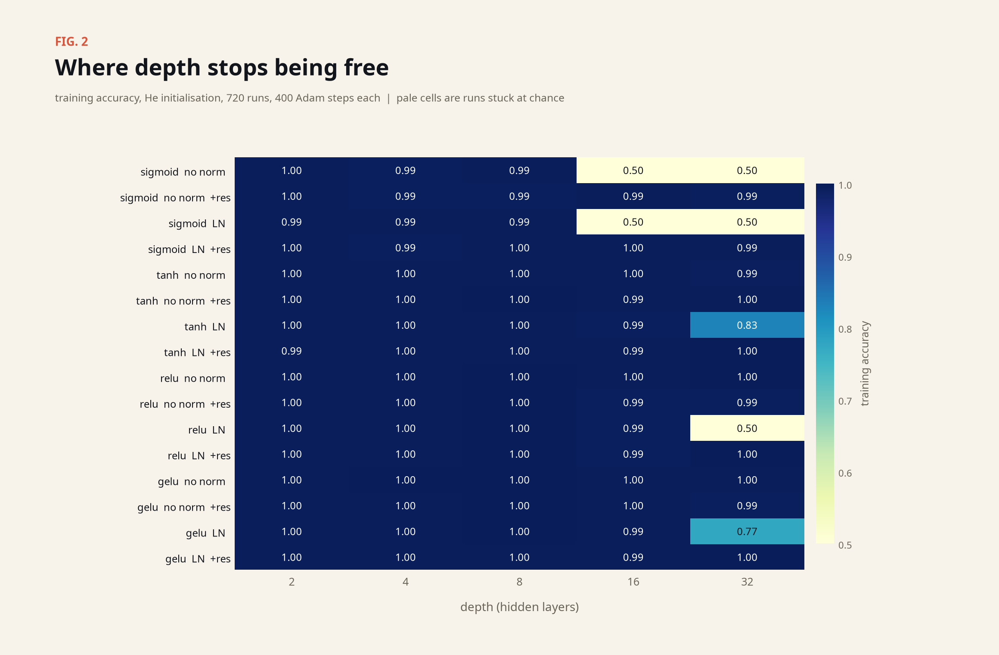
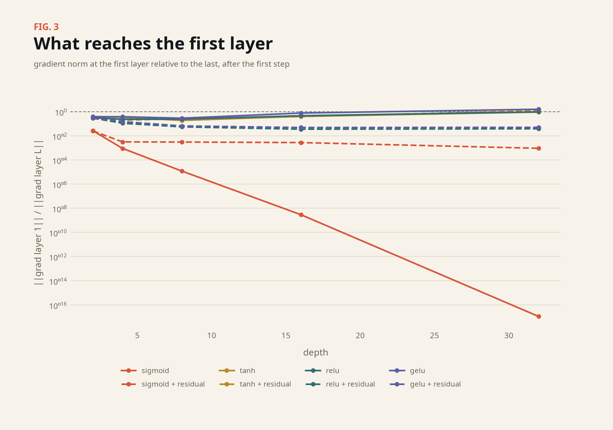
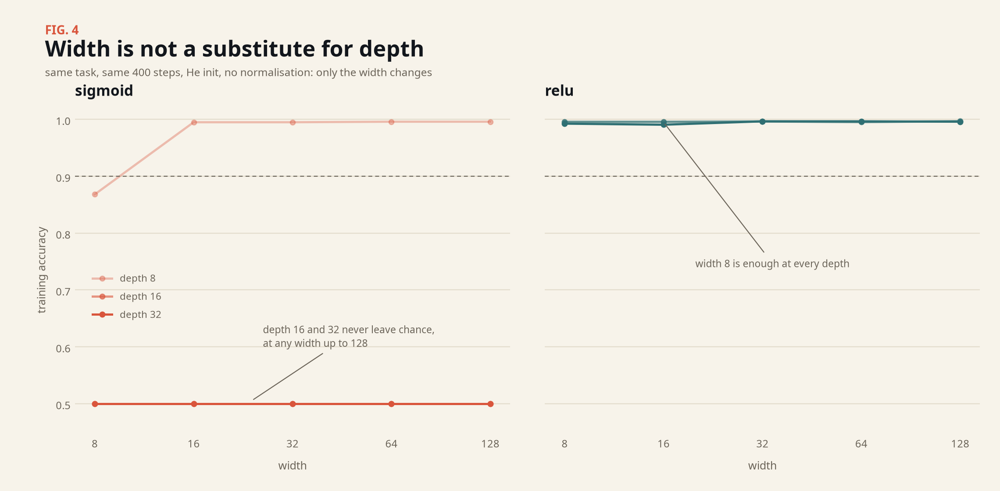
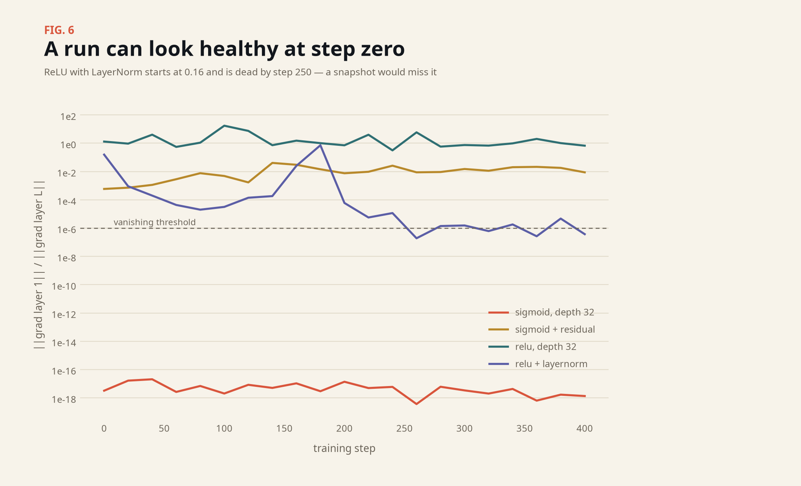
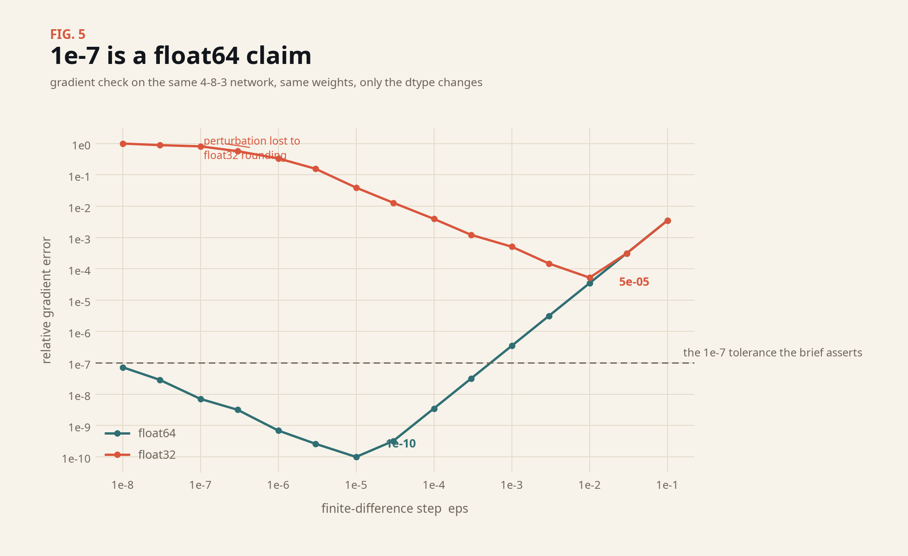

# gradient-lab

A reverse-mode autodiff engine written from scratch in NumPy, built as an instrument rather than a demo.

The question: **how deep can a network get before the gradient dies, and which single intervention buys the most depth?**

## The answer, in one paragraph

Depth is not what kills gradients. Sigmoid does. On an identical task, with identical budgets, a plain sigmoid network stops training between depth 8 and 16, and at depth 32 the gradient reaching the first layer is **1.1e-17** of the gradient at the last. Tanh, ReLU and GELU at the same depth sit at **0.90, 0.95 and 1.56**. Adding one residual connection lifts the sigmoid network from chance to **0.994** at depth 32, while widening it from 8 to 128 units — sixteen times the parameters — does not move it off chance at all.

That is the exchange rate nobody publishes: **a single skip connection buys more depth than sixteen times the width.**



## The experiment

720 runs. Four activations × three initialisations × normalisation on/off × residual on/off × five depths × three seeds. Every run uses the same task (1,600 points, two interleaved classes), the same optimiser (Adam, 3e-3), the same budget (400 steps, batch 128) and the same width (32). Nothing varies except the variable being tested. Zero runs diverged.

The depth horizon is the deepest network in each configuration that still reaches 0.90 training accuracy.

| activation | init | norm | residual | horizon |
|---|---|---|---|---|
| sigmoid | He | none | no | **8** |
| sigmoid | He | none | yes | **32** |
| sigmoid | He | LayerNorm | no | **8** |
| sigmoid | He | LayerNorm | yes | **32** |
| tanh | He | none | no | 32 |
| ReLU | He | none | no | 32 |
| GELU | He | none | no | 32 |
| ReLU | He | LayerNorm | no | **16** |

## What reaches the first layer



Measured after the first backward pass: the norm of the gradient at the first layer divided by the norm at the last. A straight line on a log axis means exponential decay per layer — for sigmoid, roughly a factor of ten every two layers. Residual connections flatten that line at about 1e-3, which is enough to train but not enough to match ReLU, and the gap is visible in the accuracy.

## Width is not a substitute for depth



Same task, same 400 steps, only the width changes. A sigmoid network at depth 8 needs 16 units; at depths 16 and 32 it never leaves chance at any width up to 128. A ReLU network needs 8 units at every depth, because its gradients do not decay in the first place.

## The failure that only shows up over time

The ReLU + LayerNorm network at depth 32 is the interesting cell, and I got it wrong the first time I described it. It starts with a **healthy** gradient ratio of 0.16 — a probe that measures at step 0 would call it fine — and by step 250 the ratio has fallen to 1.5e-6 and the accuracy has never left 0.500.



So the diagnostic in `engine/probe.py` classifies from the trajectory, not the snapshot: the level at the start, the level at the end, and the slope in decades per step.

| run | accuracy | verdict | first layer receives |
|---|---|---|---|
| sigmoid, depth 32 | 0.500 | vanishing | 3.2e-18 from the start |
| sigmoid + residual | 0.986 | healthy | 1.1e-2 |
| ReLU, depth 32 | 0.994 | healthy | 7.5e-1 |
| ReLU + LayerNorm | 0.500 | **collapsing** | 1.6e-1, decaying to 1.5e-6 |

This bounds the claim honestly: **gradient attenuation is a necessary diagnostic, not a sufficient one, and a single measurement is not enough to see it.** That is also why the probe reports a slope rather than a verdict from one number.

## 1e-7 is a float64 claim

The brief that started this project asserts a 1e-7 relative-error tolerance for gradient checks. That number is a statement about float64 arithmetic on a small parameter count, and it does not survive a change of dtype.



Same network, same weights, same finite-difference formula:

- **float64** — best relative error **9.9e-11** at eps = 1e-5, comfortably inside 1e-7.
- **float32** — best relative error **5.2e-5** at eps = 1e-2, and below eps ≈ 1e-6 the perturbation is simply lost to rounding, so the error goes to 1.
- The float32 *analytical* gradient already differs from the float64 truth by **8.8e-8**, before finite differences are involved at all.

A 1e-7 assertion at float32 is therefore testing the dtype, not the mathematics.

## How much the numbers can be trusted

Two independent checks.

**Finite differences.** Every operation is compared against central differences at float64:

```
operation                   max rel. error   grad norm
------------------------------------------------------
matmul                            8.00e-11        7.85
sigmoid                           8.26e-10        0.97
softmax_cross_entropy             7.55e-10        0.36
layernorm                         5.28e-10       33.89
------------------------------------------------------
worst case: 8.26e-10   tolerance: 1.0e-06   PASS
```

**PyTorch parity.** Finite differences prove self-consistency, not correctness. Every layer and optimiser is rebuilt in PyTorch, fed identical parameters, and compared:

```
component                         max abs diff
----------------------------------------------
linear forward / grads                0.00e+00
layernorm grad wrt input              1.42e-14
SGD + Nesterov, 5 steps               8.88e-16
Adam, 5 steps                         2.78e-17
AdamW, 5 steps                        0.00e+00
----------------------------------------------
worst deviation: 1.42e-14   tolerance 1e-12   PASS
```

The 1e-14 in LayerNorm is the reduction order of the mean, and it is the size float64 rounding predicts over four elements.

## The engine also learns and writes

XOR, solved by a 2-16-16-2 tanh network trained with a hand-rolled SGD loop — not linearly separable, so it only works if gradients flow through both hidden layers.


A character-level language model: eight characters of context, one-hot, 160 hidden units, 93,825 parameters, 6,000 Adam steps at 3.1 ms/step on one CPU core. Cross-entropy falls from 4.24 nats to 1.93 — a perplexity of about 7.


## Quickstart

```bash
python3 -m venv .venv
.venv/bin/pip install -r requirements.txt

.venv/bin/python -m pytest -q                    # 41 tests
.venv/bin/python -m scripts.verify               # gradient table
.venv/bin/python -m scripts.verify_parity        # PyTorch table
.venv/bin/python -m scripts.smoke_train          # XOR
.venv/bin/python -m scripts.char_lm              # language model

.venv/bin/python -m experiments.depth_horizon    # 720 runs, ~25 min
.venv/bin/python -m experiments.analyze          # figures 2 and 3
.venv/bin/python -m experiments.analyze_width    # figure 4
.venv/bin/python -m experiments.precision        # figure 5
.venv/bin/python -m experiments.probe_demo       # figure 6
```

## Three decisions worth knowing about

**Iterative topological sort.** The backward pass walks the graph with an explicit stack, not recursion. A 600-layer chain exceeds Python's recursion limit, and deep chains are the entire subject of this project. There is a test for exactly this.

**Gradients accumulate with `+=`.** This is what makes fan-out correct: a tensor consumed by two operations receives the sum of both contributions. It also means `zero_grad()` is mandatory between steps, as in any real framework.

**Broadcasting is undone explicitly.** When `(B, D)` and `(1, D)` are added, the gradient flowing back to the `(1, D)` operand has to be summed over the broadcast axis. `_unbroadcast` does this, and there are shape tests for it — the most common silent bug in hand-written autodiff.

## What is deliberately missing

No attention, no transformer, no C extension. Those are on the cut list, and the reasoning is in [docs/scope.md](docs/scope.md): they add engineering surface without adding to the claim.

## Roadmap

- [x] Session 1 — Tensor, DAG, topological sort, fused softmax-CE, LayerNorm, gradcheck
- [x] Session 2 — layers, initialisation schemes, optimisers, PyTorch parity, character-level LM
- [x] Session 3 — the depth-horizon grid (720 runs), the width sweep, figures 2-4
- [x] Session 4 — the probe, the float32 precision study, figures 5-6, this write-up
