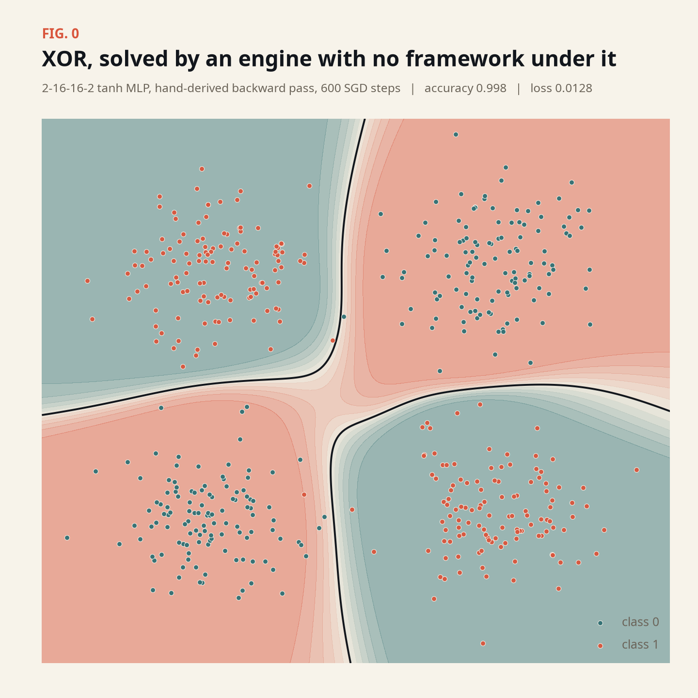

# gradient-lab

A reverse-mode autodiff engine written from scratch in NumPy, built as an instrument rather than a demo.

The question this repository answers: **how deep can a network get before the gradient dies, and which single intervention buys the most depth?** The engine is the measuring device. Everything below exists so that the measurement can be trusted.

Status: session 1 of 4 — the engine core is complete and verified.

## Verified gradients

Every operation is checked against central finite differences at float64 (`eps=1e-6`). These are measured numbers, not assertions:

```
operation                   max rel. error   grad norm
------------------------------------------------------
add (broadcast)                   2.40e-10       22.89
multiply                          1.71e-10        4.53
matmul                            8.00e-11        7.85
relu                              1.48e-10        4.00
tanh                              4.65e-11        3.08
sigmoid                           8.26e-10        0.97
gelu                              2.06e-10        3.11
exp                               4.32e-10        7.00
log                               3.43e-11        4.68
sum(axis=0)                       1.56e-10       20.27
mean(axis=1)                      8.05e-11        0.94
max(axis=1)                       6.52e-11        2.24
reshape                           2.02e-10        7.59
transpose                         1.12e-10       15.01
softmax                           5.89e-10        0.30
softmax_cross_entropy             7.55e-10        0.36
layernorm                         5.28e-10       33.89
------------------------------------------------------
worst case: 8.26e-10   tolerance: 1.0e-06   PASS
```

The worst case sits three orders of magnitude inside the tolerance, which is what float64 arithmetic on small tensors should give you. The interesting question — what happens to that floor at float32 — is the precision study in session 3.

## End-to-end check

XOR is not linearly separable, so a two-layer network can only solve it if gradients flow through both hidden layers:

```
$ python -m scripts.smoke_train
step    0   loss 1.1839   accuracy 0.515
step  150   loss 0.0214   accuracy 0.996
step  600   loss 0.0128   accuracy 0.998
```



## Quickstart

```bash
python3 -m venv .venv
.venv/bin/pip install -r requirements.txt

.venv/bin/python -m pytest -q          # 28 tests
.venv/bin/python -m scripts.verify     # the table above
.venv/bin/python -m scripts.smoke_train
```

## Three decisions worth knowing about

**Iterative topological sort.** The backward pass walks the graph with an explicit stack, not recursion. A 600-layer chain exceeds Python's recursion limit, and deep chains are the entire subject of this project. There is a test for exactly this.

**Gradients accumulate with `+=`.** This is what makes fan-out correct: a tensor consumed by two operations receives the sum of both contributions. It also means `zero_grad()` is mandatory between steps, as in any real framework.

**Broadcasting is undone explicitly.** When `(B, D)` and `(1, D)` are added, the gradient flowing back to the `(1, D)` operand has to be summed over the broadcast axis. `_unbroadcast` does this, and there are shape tests for it — this is the single most common silent bug in hand-written autodiff.

## What is deliberately missing

No attention, no transformer, no C extension. Those are on the cut list, and the reasoning is in `docs/scope.md`: they add engineering surface without adding to the claim.

## Roadmap

- [x] Session 1 — Tensor, DAG, topological sort, fused softmax-CE, LayerNorm, gradcheck
- [ ] Session 2 — Linear, Dropout, optimisers (SGD, momentum, Nesterov, Adam, AdamW), PyTorch parity suite
- [ ] Session 3 — the depth-horizon experiment and the precision study
- [ ] Session 4 — figures, probe classifier, write-up
